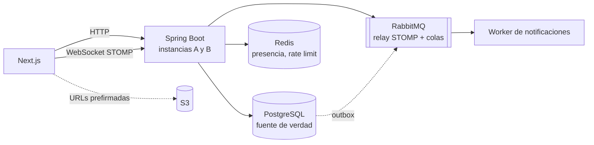

# realtime-chat

**Español** · [English](README.md)

Un chat en tiempo real estilo Discord (servidores, canales públicos y privados, links de
invitación y, más adelante, presencia, menciones, adjuntos y búsqueda) construido alrededor
de **dos garantías que se prueban a propósito**, no solo se afirman:

1. **Entrega:** todo mensaje confirmado llega a cada miembro del canal **exactamente una vez
   y en el mismo orden para todos**, aunque el cliente se desconecte, reintente o el
   backend tenga varias instancias.
2. **Autorización:** nadie lee ni escribe en un canal al que no pertenece, ni por HTTP ni
   por WebSocket, **ni siquiera un segundo después de que lo expulsen**.

  

> **Estado: hito 4 de 9.** La autorización por HTTP y por WebSocket, el orden de los mensajes
> y la entrega en tiempo real entre dos instancias del backend están construidos y
> verificados, con un arnés de entrega de semillas fijas. Presencia, menciones, adjuntos y
> búsqueda todavía no existen. Nada de lo que sigue afirma un resultado que no exista.

## Estado

| Hito | Qué | Estado |
|---|---|---|
| 1 | Auth (bcrypt + JWT), usuarios, servidores, Flyway | hecho |
| 2 | Canales, invitaciones, roles, `AccessPolicy`, matriz de autorización HTTP | hecho |
| 3 | Mensajes: `seq` por canal, envío idempotente, paginación por cursor | hecho |
| 4 | Tiempo real: relay STOMP a RabbitMQ, dos instancias, resincronización por `seq`, arnés de entrega | **hecho** |
| 5 | Presencia y rate limiting | planeado |
| 6 | Menciones: outbox, worker, reintentos, cola de mensajes muertos | planeado |
| 7 | Adjuntos (URLs prefirmadas de S3) | planeado |
| 8 | Búsqueda y no leídos | planeado |
| 9 | Despliegue, pruebas de extremo a extremo, mediciones | planeado |

## Lo que ya está demostrado (hitos 2 a 4)

- **Una sola `AccessPolicy` decide todo acceso.** Los controladores nunca revisan permisos
  por su cuenta. Lee los roles de la base de datos en cada solicitud, nunca del JWT, así
  que un expulsado queda fuera en la solicitud siguiente aunque su token siga vigente.
- **404 si no puedes ver el recurso, 403 si lo ves pero no tienes el rol.** Quien no es
  miembro recibe 404 en un canal privado, para que la respuesta no confirme que existe.
- **Una matriz de autorización como tests:** cada endpoint × 6 tipos de usuario (owner,
  admin, member, miembro de otro servidor, sin sesión, expulsado hace un segundo), un test
  por celda, 144 en total, contra un PostgreSQL real. Un test falla si existe un endpoint
  que no está en la matriz, y otro si [`docs/AUTHZ.md`](docs/AUTHZ.md) se desvía de ella.
  Rompí un permiso a propósito y agregué un endpoint sin fila para comprobar que la matriz
  lo nota; lo notó.
- **El límite de usos de una invitación resiste la concurrencia.** Aceptar una invitación
  gasta un uso con un solo `UPDATE … WHERE uses < max_uses` atómico. Con `max_uses = 1`,
  diez aceptaciones simultáneas dejan entrar exactamente a una (también probado con
  límite 3).
- **`seq` por canal sin repetidos ni huecos.** 50 envíos simultáneos a un canal reciben los
  `seq` 1 a 50. Cambiar el `UPDATE … RETURNING` atómico por un `SELECT max(seq) + 1`
  ingenuo hace fallar el test con `seq` repetidos.
- **Los reintentos no duplican ni dejan huecos.** Diez reintentos simultáneos de un mismo
  mensaje (mismo `client_msg_id`) lo guardan una vez y dejan `last_seq = 1`: los que pierden
  la carrera revierten el `seq` que reservaron ([ADR 0005](docs/adr/0005-envio-idempotente-sin-huecos.md)).
  Sin ese rollback el test termina con `last_seq = 10`.
- **Paginación por cursor sobre `seq`:** `after_seq` para ponerse al día y `before_seq` para
  el historial. La página del canal usa los dos, y se resincroniza sola cuando un mensaje
  enviado revela un hueco.

- **Entrega en vivo entre dos instancias.** Un mensaje guardado en la instancia A llega a un
  cliente conectado a la B, en el mismo orden, por un relay STOMP de RabbitMQ. Los avisos
  salen solo después del commit: un envío revertido no publica nada, un reintento no publica
  nada y diez reintentos simultáneos publican exactamente un mensaje.
- **Nadie puede escribir por el WebSocket.** Los mensajes se escriben solo por HTTP; todo
  `SEND` por STOMP se rechaza, porque con el relay un `SEND` a `/topic/channel.N` llegaría a
  los suscriptores sin pasar por el `seq` ni por `AccessPolicy`
  ([ADR 0006](docs/adr/0006-envio-solo-por-http.md)). `SUBSCRIBE` pasa por `AccessPolicy` y lee
  la base en cada suscripción, y una segunda matriz lo cubre (8 filas × 6 tipos de usuario,
  48 celdas, en [`docs/AUTHZ.md`](docs/AUTHZ.md)).
- **Expulsar corta los sockets en todas las instancias.** La instancia que atiende la
  expulsión cierra los suyos y lo avisa por un exchange fanout de RabbitMQ para que la otra
  haga lo mismo ([ADR 0007](docs/adr/0007-cerrar-sockets-al-expulsar.md)). Con un token que
  sigue vigente, el expulsado puede reconectar pero recibe 404 en cada suscripción.
- **Un arnés de entrega ([`harness/`](harness)).** 8 clientes envían 640 mensajes a la vez a
  un canal, a través de un balanceador delante de dos instancias, se desconectan y reconectan
  a cualquiera de las dos, reenvían mensajes confirmados, y a mitad de la corrida se reinicia
  una instancia. Seis corridas con semilla terminaron con cero violaciones de las cuatro
  invariantes (completo, sin duplicados, mismo orden, fiel); los números y lo que no
  demuestran están en [`docs/DELIVERY.md`](docs/DELIVERY.md). Su primera corrida con la
  semilla 2 **falló** y encontró un error real del cliente (el cursor de resincronización
  debe ser el final de la racha sin huecos, no el mayor `seq`); está arreglado y documentado
  ahí.

363 tests del backend (unitarios, `@WebMvcTest`, integración con Testcontainers con
PostgreSQL y RabbitMQ reales) y 40 del arnés, formateados con Spotless.

## El diseño en 30 segundos

El chat es la parte fácil. Los dos problemas difíciles y la respuesta planeada a cada uno
(detalle en [`DESIGN.md`](DESIGN.md), decisiones en [`docs/adr/`](docs/adr)):

- **Orden y pérdida:** cada mensaje recibe un `seq` que crece de uno en uno dentro de su
  canal, asignado por la base de datos en la misma transacción que lo guarda. Cada cliente
  recuerda el último `seq` que vio: al reconectar pide `GET …/messages?after_seq=N`, un
  hueco (N+2 sin N+1) se detecta y se pide, y los duplicados se descartan. Un
  `client_msg_id` generado por el cliente, con `UNIQUE (author_id, client_msg_id)`, vuelve
  idempotentes los reintentos.
- **Varias instancias:** STOMP sobre un relay a RabbitMQ en vez del broker en memoria de
  Spring, para que un suscriptor en la instancia B reciba lo enviado por la A. Los avisos
  se publican solo después del commit, y los eventos de menciones pasan por una tabla
  *outbox* para que no se pierdan.
- **Autorización por WebSocket:** la misma `AccessPolicy` corre en cada `SUBSCRIBE`, todo
  `SEND` se rechaza (los mensajes se escriben solo por HTTP), y expulsar a alguien cierra sus
  sesiones abiertas en todas las instancias.



Hoy existen PostgreSQL, la API REST, el frontend, el relay STOMP de RabbitMQ y el cluster
de dos instancias; Redis (presencia, rate limiting) y el worker de notificaciones llegan en
los hitos 5 y 6.

## Documentos

| Archivo | Qué es |
|---|---|
| [`DESIGN.md`](DESIGN.md) | El diseño, escrito antes del código: problemas, decisiones, plan de verificación, hitos |
| [`docs/AUTHZ.md`](docs/AUTHZ.md) | Las reglas de autorización y las matrices HTTP y STOMP completas (las verifican tests) |
| [`docs/adr/`](docs/adr) | Siete decisiones: `seq` por canal, broker externo, publicar tras el commit, outbox, envío idempotente sin huecos, escribir solo por HTTP, cerrar sockets al expulsar |
| [`docs/DELIVERY.md`](docs/DELIVERY.md) | La garantía de entrega, el arnés, sus resultados y sus límites |
| [`docs/v2.md`](docs/v2.md) | Ideas que quedaron fuera a propósito (bans, revocar invitaciones…) |

> El texto de la interfaz, los mensajes de error de la API y los documentos de diseño están
> en español (el proyecto nació como trabajo de curso en español); los identificadores del
> código y el README principal están en inglés.

## Cómo correrlo

Requisitos: Docker, Java 21 y Node 20+.

```bash
cp .env.example .env
docker compose up -d                     # PostgreSQL 17, Redis 7, RabbitMQ 4 (con STOMP)

cd backend
./mvnw spotless:check verify             # todos los tests; requiere Docker encendido (Testcontainers)
set -a && source ../.env && set +a       # la app lee estas variables de entorno
./mvnw spring-boot:run                   # API en :8080

cd ../frontend
npm install && npm run dev               # app en :3000, /api se reenvía al backend
```

Para levantar dos instancias detrás de un balanceador (lo necesita el arnés) y correr el arnés:

```bash
docker compose --profile cluster up -d --build   # backend-a :8081, backend-b :8082, balanceador :8088
backend/mvnw -f harness/pom.xml compile exec:java -Dexec.args="--seed 42"
```

Para usar el cluster desde el navegador, el frontend se arranca con
`API_URL=http://localhost:8088 NEXT_PUBLIC_WS_URL=ws://localhost:8088/ws npm run dev`.

Para regenerar las matrices de `docs/AUTHZ.md` después de cambiarlas:
`./mvnw test -Dtest='AuthorizationMatrixTest,StompAuthorizationMatrixTest' -Dauthz.update=true`.

Los valores por defecto de `application.properties` (`dev-password`, un secreto JWT de
desarrollo) son solo para uso local; en un despliegue real se sobrescriben con variables de
entorno (`JWT_SECRET` de al menos 32 caracteres).

## Estructura

```
backend/    Spring Boot 4.1 (Java 21): auth, server, channel, invite, message, realtime, access
frontend/   Next.js 16: login, registro, servidores, canales (en vivo), página de invitación
harness/    arnés de entrega: N clientes STOMP contra dos instancias, cuatro invariantes
nginx/      configuración del balanceador del cluster de dos instancias
docs/       matrices de autorización, resultados de entrega, ADR, ideas para v2
```

## Fuera de alcance

Voz y video, roles personalizados, bots e integraciones, cifrado de extremo a extremo,
federación, app móvil nativa y competir con Discord. Ver la §2 de [`DESIGN.md`](DESIGN.md):
nada fuera de esa lista entra antes del hito 9.

## Licencia

[MIT](LICENSE)
