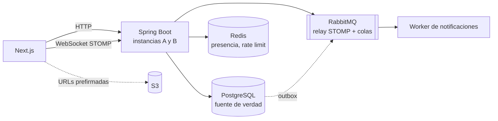

# realtime-chat

**Español** · [English](README.md)

Un chat en tiempo real estilo Discord (servidores, canales públicos y privados, links de
invitación y, más adelante, presencia, menciones, adjuntos y búsqueda) construido alrededor
de **dos garantías que se prueban a propósito**, no solo se afirman:

1. **Entrega:** todo mensaje confirmado llega a cada miembro del canal **exactamente una vez
   y en el mismo orden para todos**, aunque el cliente se desconecte, reintente o el
   backend tenga varias instancias.
2. **Autorización:** nadie lee ni escribe en un canal al que no pertenece, ni por HTTP ni
   por WebSocket, **ni siquiera un segundo después de que lo expulsen**.

  

> **Estado: hito 2 de 9.** La autorización por HTTP está construida y verificada; la
> garantía de entrega en tiempo real está diseñada pero **todavía no implementada**
> (hito 4). Nada de lo que sigue afirma un resultado que no exista.

## Estado

| Hito | Qué | Estado |
|---|---|---|
| 1 | Auth (bcrypt + JWT), usuarios, servidores, Flyway | hecho |
| 2 | Canales, invitaciones, roles, `AccessPolicy`, matriz de autorización HTTP | **hecho** |
| 3 | Mensajes: `seq` por canal, envío idempotente, paginación por cursor | siguiente |
| 4 | Tiempo real: relay STOMP a RabbitMQ, dos instancias, resincronización por `seq`, arnés de entrega | planeado |
| 5 | Presencia y rate limiting | planeado |
| 6 | Menciones: outbox, worker, reintentos, cola de mensajes muertos | planeado |
| 7 | Adjuntos (URLs prefirmadas de S3) | planeado |
| 8 | Búsqueda y no leídos | planeado |
| 9 | Despliegue, pruebas de extremo a extremo, mediciones | planeado |

## Lo que ya está demostrado (hito 2)

- **Una sola `AccessPolicy` decide todo acceso.** Los controladores nunca revisan permisos
  por su cuenta. Lee los roles de la base de datos en cada solicitud, nunca del JWT, así
  que un expulsado queda fuera en la solicitud siguiente aunque su token siga vigente.
- **404 si no puedes ver el recurso, 403 si lo ves pero no tienes el rol.** Quien no es
  miembro recibe 404 en un canal privado, para que la respuesta no confirme que existe.
- **Una matriz de autorización como tests:** cada endpoint × 6 tipos de usuario (owner,
  admin, member, miembro de otro servidor, sin sesión, expulsado hace un segundo), un test
  por celda, 108 en total, contra un PostgreSQL real. Un test falla si existe un endpoint
  que no está en la matriz, y otro si [`docs/AUTHZ.md`](docs/AUTHZ.md) se desvía de ella.
  Rompí un permiso a propósito y agregué un endpoint sin fila para comprobar que la matriz
  lo nota; lo notó.
- **El límite de usos de una invitación resiste la concurrencia.** Aceptar una invitación
  gasta un uso con un solo `UPDATE … WHERE uses < max_uses` atómico. Con `max_uses = 1`,
  diez aceptaciones simultáneas dejan entrar exactamente a una (también probado con
  límite 3).

168 tests en total (unitarios, `@WebMvcTest`, integración con Testcontainers), formateados
con Spotless.

## El diseño en 30 segundos

El chat es la parte fácil. Los dos problemas difíciles y la respuesta planeada a cada uno
(detalle en [`DESIGN.md`](DESIGN.md), decisiones en [`docs/adr/`](docs/adr)):

- **Orden y pérdida:** cada mensaje recibe un `seq` que crece de uno en uno dentro de su
  canal, asignado por la base de datos en la misma transacción que lo guarda. Cada cliente
  recuerda el último `seq` que vio: al reconectar pide `GET …/messages?after_seq=N`, un
  hueco (N+2 sin N+1) se detecta y se pide, y los duplicados se descartan. Un
  `client_msg_id` generado por el cliente, con `UNIQUE (author_id, client_msg_id)`, vuelve
  idempotentes los reintentos.
- **Varias instancias:** STOMP sobre un relay a RabbitMQ en vez del broker en memoria de
  Spring, para que un suscriptor en la instancia B reciba lo enviado por la A. Los avisos
  se publican solo después del commit, y los eventos de menciones pasan por una tabla
  *outbox* para que no se pierdan.
- **Autorización por WebSocket:** la misma `AccessPolicy` corre en `SUBSCRIBE` y `SEND`, y
  expulsar a alguien cierra sus sesiones abiertas.



Hoy solo existen PostgreSQL, la API REST y el frontend; Redis, RabbitMQ y la segunda
instancia llegan en los hitos 4 a 6.

## Documentos

| Archivo | Qué es |
|---|---|
| [`DESIGN.md`](DESIGN.md) | El diseño, escrito antes del código: problemas, decisiones, plan de verificación, hitos |
| [`docs/AUTHZ.md`](docs/AUTHZ.md) | Las reglas de autorización y la matriz HTTP completa (la verifica un test) |
| [`docs/adr/`](docs/adr) | Cuatro decisiones: `seq` por canal, broker externo, publicar tras el commit, outbox |
| [`docs/DELIVERY.md`](docs/DELIVERY.md) | El arnés de entrega y sus resultados (vacío hasta el hito 4) |
| [`docs/v2.md`](docs/v2.md) | Ideas que quedaron fuera a propósito (bans, revocar invitaciones…) |

> El texto de la interfaz, los mensajes de error de la API y los documentos de diseño están
> en español (el proyecto nació como trabajo de curso en español); los identificadores del
> código y el README principal están en inglés.

## Cómo correrlo

Requisitos: Docker, Java 21 y Node 20+.

```bash
cp .env.example .env
docker compose up -d                     # PostgreSQL 17, Redis 7, RabbitMQ 4 (con STOMP)

cd backend
./mvnw spotless:check verify             # todos los tests; requiere Docker encendido (Testcontainers)
set -a && source ../.env && set +a       # la app lee estas variables de entorno
./mvnw spring-boot:run                   # API en :8080

cd ../frontend
npm install && npm run dev               # app en :3000, /api se reenvía al backend
```

Para regenerar la matriz de `docs/AUTHZ.md` después de cambiarla:
`./mvnw test -Dtest=AuthorizationMatrixTest -Dauthz.update=true`.

Los valores por defecto de `application.properties` (`dev-password`, un secreto JWT de
desarrollo) son solo para uso local; en un despliegue real se sobrescriben con variables de
entorno (`JWT_SECRET` de al menos 32 caracteres).

## Estructura

```
backend/    Spring Boot 4.1 (Java 21): auth, server, channel, invite, access (AccessPolicy)
frontend/   Next.js 16: login, registro, servidores, canales, página de invitación
docs/       matriz de autorización, arnés de entrega, ADR, ideas para v2
```

## Fuera de alcance

Voz y video, roles personalizados, bots e integraciones, cifrado de extremo a extremo,
federación, app móvil nativa y competir con Discord. Ver la §2 de [`DESIGN.md`](DESIGN.md):
nada fuera de esa lista entra antes del hito 9.

## Licencia

[MIT](LICENSE)
