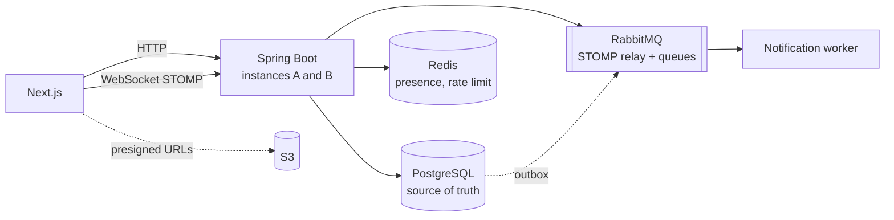

# realtime-chat

[Español](README.es.md) · **English**

A Discord-style real-time chat (servers, public and private channels, invite links, and
later presence, mentions, attachments and search) built around **two guarantees that are
tested on purpose**, not just claimed:

1. **Delivery:** every confirmed message reaches every channel member **exactly once and in
   the same order for everyone**, even across reconnects, client retries and several backend
   instances.
2. **Authorization:** nobody reads or writes a channel they don't belong to, over HTTP or
   WebSocket, **not even one second after being kicked**.

  

> **Status: milestone 2 of 9.** Authorization over HTTP is built and verified; the real-time
> delivery guarantee is designed but **not implemented yet** (milestone 4). Nothing below
> claims a result that does not exist.

## Status

| Milestone | What | State |
|---|---|---|
| 1 | Auth (bcrypt + JWT), users, servers, Flyway | done |
| 2 | Channels, invite links, roles, `AccessPolicy`, HTTP authorization matrix | **done** |
| 3 | Messages: per-channel `seq`, idempotent send, cursor pagination | next |
| 4 | Real time: STOMP relay to RabbitMQ, two instances, resync by `seq`, delivery harness | planned |
| 5 | Presence and rate limiting | planned |
| 6 | Mentions: outbox, worker, retries, dead-letter queue | planned |
| 7 | Attachments (presigned S3 URLs) | planned |
| 8 | Search and unread counts | planned |
| 9 | Deployment, end-to-end tests, measurements | planned |

## What is already proven (milestone 2)

- **A single `AccessPolicy` decides every access.** Controllers never check permissions on
  their own. It reads roles from the database on every request, never from the JWT, so a
  kicked user is out on the very next request even though their token is still valid.
- **404 when you can't see the resource, 403 when you can see it but lack the role.** A
  non-member gets 404 on a private channel, so the response doesn't confirm it exists.
- **An authorization matrix as tests:** every endpoint × 6 kinds of user (owner, admin,
  member, member of another server, unauthenticated, kicked a second ago), one test per
  cell, 108 in total, against a real PostgreSQL. A test fails if an endpoint exists that is
  not in the matrix, and another fails if [`docs/AUTHZ.md`](docs/AUTHZ.md) drifts from it.
  I broke a permission on purpose and added an unlisted endpoint to check the matrix
  notices; it did.
- **Invite usage limits survive concurrency.** Accepting an invite spends a use with one
  atomic `UPDATE … WHERE uses < max_uses`. With `max_uses = 1`, ten simultaneous accepts let
  exactly one in (also tested with a limit of 3).

168 tests in total (unit, `@WebMvcTest`, Testcontainers integration), Spotless-formatted.

## The design in 30 seconds

The chat is the easy part. The two hard problems, and the planned answer to each
(details in [`DESIGN.md`](DESIGN.md), decisions in [`docs/adr/`](docs/adr)):

- **Ordering and loss:** each message gets a `seq` that grows by one inside its channel,
  assigned by the database in the same transaction that stores the message. Clients
  remember the last `seq` they saw, so reconnecting is `GET …/messages?after_seq=N`, a gap
  (N+2 without N+1) is detected and fetched, and duplicates are dropped. A client-generated
  `client_msg_id` with `UNIQUE (author_id, client_msg_id)` makes retries idempotent.
- **Several instances:** STOMP over a RabbitMQ broker relay instead of Spring's in-memory
  broker, so a subscriber on instance B receives what was sent through A. Notifications are
  published only after the transaction commits, and mention events go through an outbox
  table so they can't be lost.
- **Authorization over WebSocket:** the same `AccessPolicy` runs on `SUBSCRIBE` and `SEND`,
  and kicking someone closes their open sessions.



Only PostgreSQL, the REST API and the frontend exist today; Redis, RabbitMQ and the second
instance arrive in milestones 4–6.

## Documents

| File | What it is |
|---|---|
| [`DESIGN.md`](DESIGN.md) | The design, written before the code: problems, decisions, verification plan, milestones |
| [`docs/AUTHZ.md`](docs/AUTHZ.md) | The authorization rules and the full HTTP matrix (checked by a test) |
| [`docs/adr/`](docs/adr) | Four decision records: per-channel `seq`, external broker, publish after commit, outbox |
| [`docs/DELIVERY.md`](docs/DELIVERY.md) | The delivery harness and its results (placeholder until milestone 4) |
| [`docs/v2.md`](docs/v2.md) | Ideas left out on purpose (bans, invite revocation…) |

> UI text, API error messages and the design documents are in Spanish (the project started
> as a Spanish-language course project); code identifiers and this README are in English.

## How to run it

Requirements: Docker, Java 21 and Node 20+.

```bash
cp .env.example .env
docker compose up -d                     # PostgreSQL 17, Redis 7, RabbitMQ 4 (STOMP enabled)

cd backend
./mvnw spotless:check verify             # all tests; needs Docker running (Testcontainers)
set -a && source ../.env && set +a       # the app reads these as environment variables
./mvnw spring-boot:run                   # API on :8080

cd ../frontend
npm install && npm run dev               # app on :3000, /api is proxied to the backend
```

To regenerate the matrix in `docs/AUTHZ.md` after changing it:
`./mvnw test -Dtest=AuthorizationMatrixTest -Dauthz.update=true`.

The defaults in `application.properties` (`dev-password`, a development JWT secret) are for
local use only; override them with environment variables (`JWT_SECRET` must be at least 32
characters) in any real deployment.

## Layout

```
backend/    Spring Boot 4.1 (Java 21): auth, server, channel, invite, access (AccessPolicy)
frontend/   Next.js 16: login, register, servers, channels, invite page
docs/       authorization matrix, delivery harness, ADRs, ideas for v2
```

## Out of scope

Voice and video, custom roles, bots and integrations, end-to-end encryption, federation, a
native mobile app, and competing with Discord. See [`DESIGN.md`](DESIGN.md) §2: nothing
outside that list enters before milestone 9.

## License

[MIT](LICENSE)
